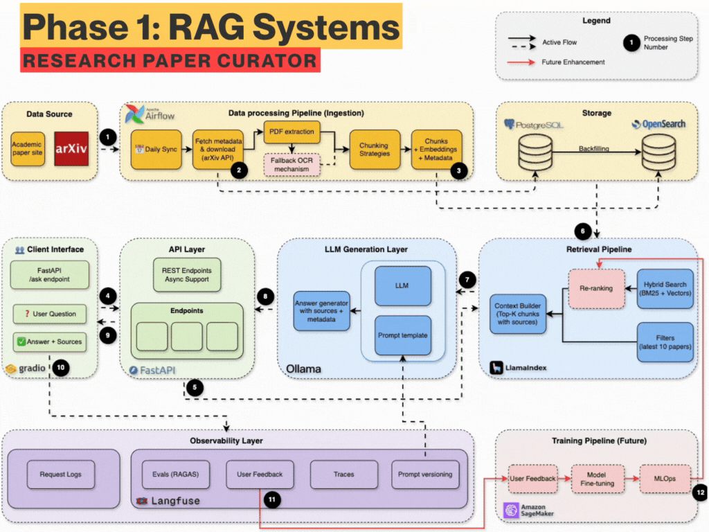
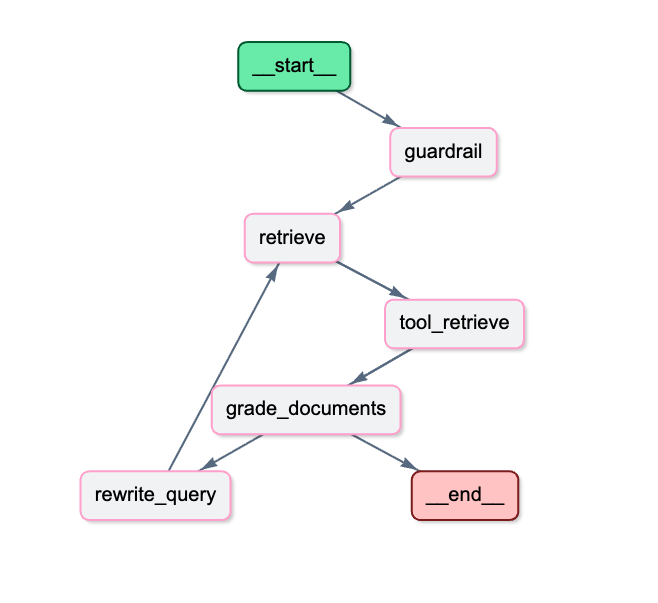

# arXiv Paper Curator (Agentic RAG System)

  <h3>Production-grade AI Agent for Academic Research</h3>
  
An intelligent system that automatically ingests arXiv research papers, indexes them for hybrid search, and answers complex natural-language questions using an Agentic RAG architecture (LangGraph + OpenAI + AWS Bedrock).

  
  
  
  
  
  
  

## 🚀 Overview

This project is a complete end-to-end cloud-native application. It autonomously curates the latest Computer Science and Artificial Intelligence research papers from arXiv, processes them into vectorized chunks, and stores them in a robust AWS OpenSearch database. 

A LangGraph-powered AI Agent sits on top of this knowledge base. When asked a question (via Telegram or API), the agent independently evaluates the query, retrieves relevant papers using Hybrid Search (BM25 + Semantic), verifies the context, and synthesizes a highly accurate technical answer. 

  

## ✨ Key Features

* **Automated Data Pipeline (Airflow):** A scheduled Airflow DAG fetches daily papers from the arXiv API, extracts text, and chunks it efficiently.
* **Hybrid Search (OpenSearch):** Combines traditional keyword search (BM25) with dense semantic search (Jina AI Embeddings) for unparalleled retrieval accuracy.
* **Agentic RAG (LangGraph):** The agent doesn't just blindly answer. It grades retrieved documents. If they are irrelevant, it rewrites your query and searches again before answering!
* **Enterprise Security (AWS Bedrock Guardrails):** All inputs and outputs are scanned by AWS Bedrock Guardrails to prevent prompt injections, toxicity, and hallucinations.
* **Production Deployment (AWS EKS):** The entire stack (FastAPI, Airflow, OpenSearch) is containerized and deployed on an Amazon Elastic Kubernetes Service (EKS) cluster with zero-downtime rolling updates.
* **Full CI/CD:** GitHub Actions automatically builds Docker images, pushes them to AWS ECR, and deploys them to the Kubernetes cluster upon code push.

  

## 🛠️ Technology Stack

* **Backend API:** FastAPI, Python 3.12, Uvicorn
* **AI & Orchestration:** LangChain, LangGraph, OpenAI (GPT-4o-mini), Jina AI
* **Databases & Caching:** AWS OpenSearch (Vector DB), PostgreSQL (Airflow Metadata), Redis (Upstash)
* **Infrastructure:** AWS EKS, EC2, EBS CSI, Elastic Load Balancers
* **DevOps:** Docker, Kubernetes (kubectl, eksctl), GitHub Actions

## 📁 Project Structure

`	ext
.
├── airflow/                 # Airflow DAGs and ingestion logic
├── deployment/              # Kubernetes YAML manifests for all services
├── src/                     # FastAPI application and LangGraph agent code
├── static/                  # Architecture diagrams and GIFs
├── .github/workflows/       # CI/CD pipelines (cd.yml)
├── deployment.md            # Detailed guide for AWS EKS deployment
├── Dockerfile               # Dockerfile for FastAPI app
├── requirements.txt         # Dependencies for FastAPI
└── requirements-airflow.txt # Dependencies for Airflow
`

## 🔌 API Endpoints

The API is fully documented via Swagger UI at /docs.

| Endpoint | Method | Description |
|----------|--------|-------------|
| /api/v1/health | GET | Service health check (OpenSearch, DB, LLM) |
| /api/v1/ask-agentic | POST | Triggers the Agentic RAG workflow |
| /api/v1/hybrid-search/ | POST | Direct access to OpenSearch Hybrid Search |

## 🚀 How to Run & Deploy

For complete, step-by-step instructions on how to set up the AWS EKS cluster, configure IAM policies, and deploy this project to the cloud, please read the **[deployment.md](deployment.md)** guide included in this repository.

To enable automated CI/CD:
1. Add your .env variables to GitHub Repository Secrets.
2. Push your code to the deployment branch.
3. GitHub Actions will handle the rest!

## 📜 License
This project is open-source and available under the MIT License.
